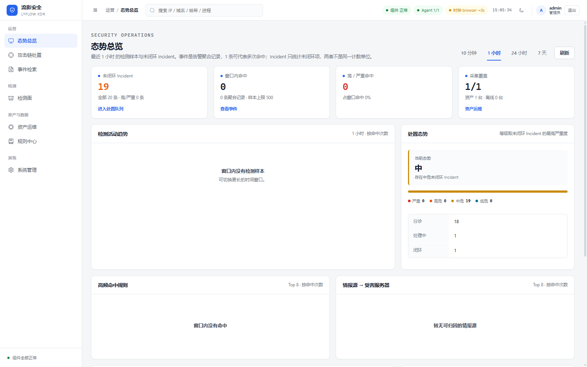
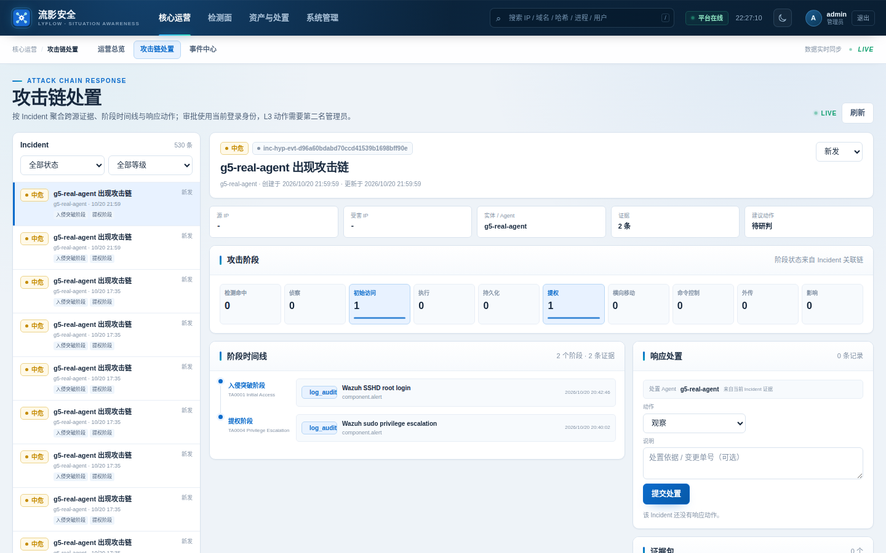
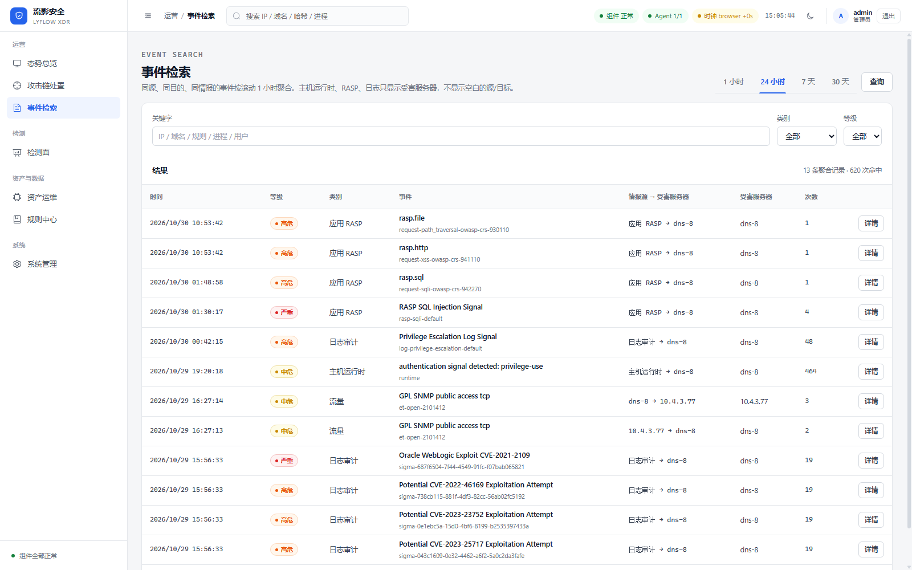
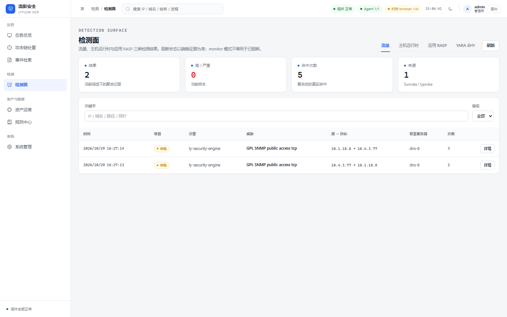
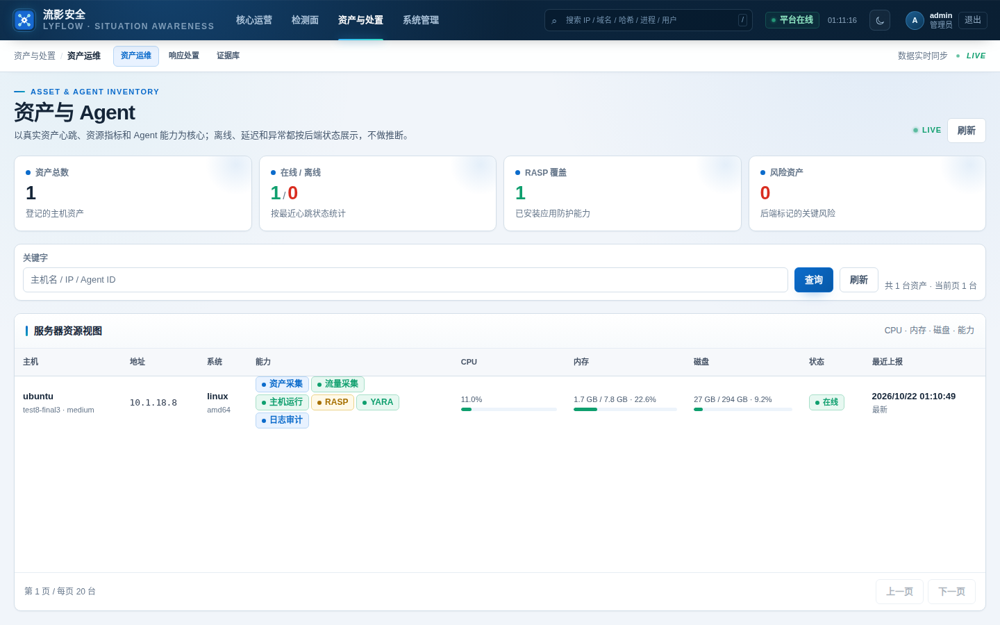
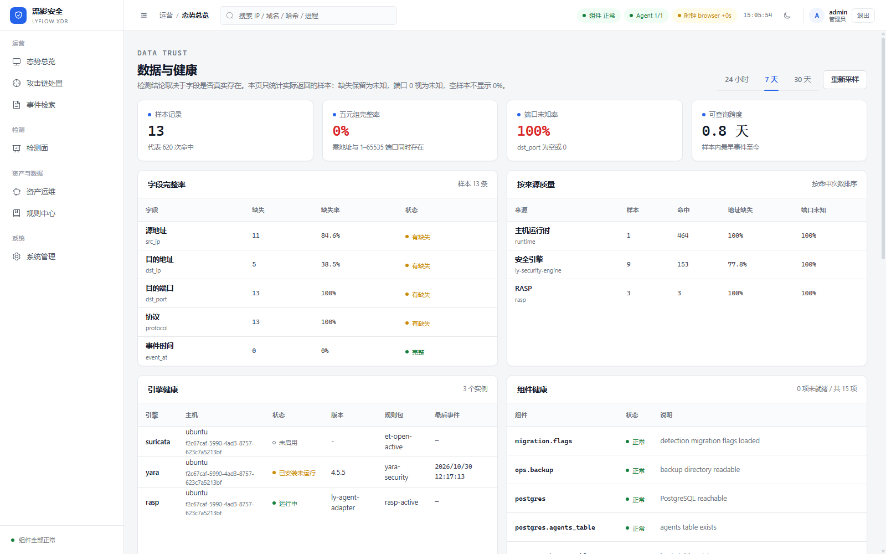
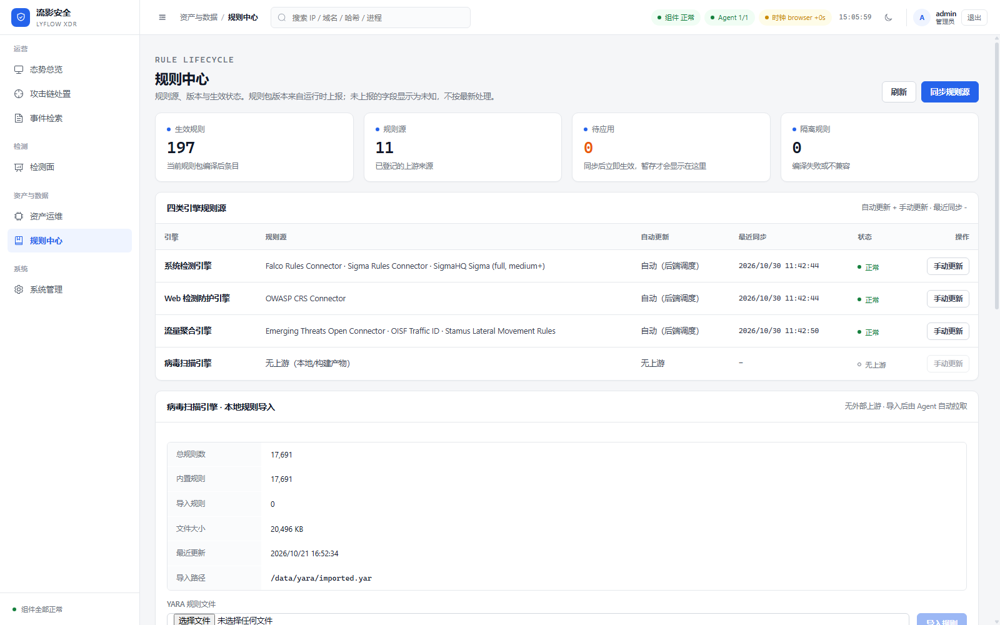
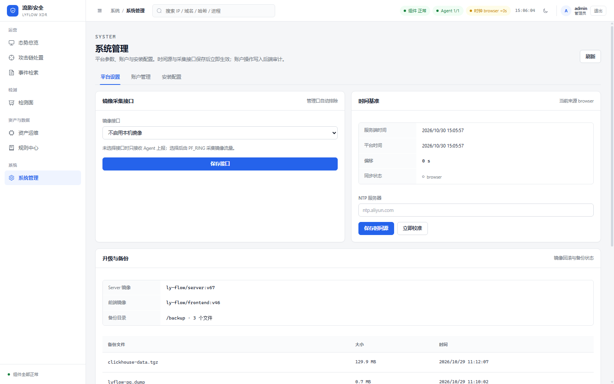
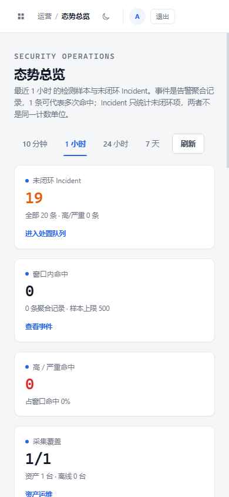

# 流影 LyFlow XDR 安全态势感知平台

流影 LyFlow 1.0 是面向单机安全设备和中小型安全运营场景的一体化 XDR 平台。服务端通过镜像口分析南北向流量，外部 Linux 主机通过无容器 Agent 上报运行时、日志、RASP、YARA 和网络遥测；平台统一完成存储、检测、ATT&CK 关联、Incident 处置和可视化。

## 1.0 正式版（2026-10-31）

- **检测能力**：Suricata 传感器加载 ET Open 全量签名（约 3.8 万条）+ 自写规则，
  流量转换规则 182 条、lyprobe 6 条进入 flow 引擎，两套引擎职责分离；
- **检测面**：流量、主机运行时、应用 RASP、YARA 四类，阻断以端侧证据为准；
- **降噪**：ET INFO/POLICY/HUNTING/DNS 启发式等低价值家族默认剔除，
  转换规则有保真门禁，历史误报规则已退役且不会随同步回归；
- **规则更新**：ET Open 每日 03:30 自动刷新（失败保留旧库），
  flow 引擎规则支持定时同步、版本化与热加载；
- **主动防御**：RASP 请求级拦截实测 SQLi / XSS / 路径穿越返回 403，正常请求 200；
  defense 支持 dry-run → active → stop/expire 回 monitor；
- **数据保留**：原始 EVE 48 小时、traffic_sessions 3 天、threat_events 30 天；
- **Agent**：Linux AMD64/ARM64，二进制/配置/策略签名校验开启；
- **CI**：Go、前端、Python RASP 与策略检查全部通过。

> 详细验收记录见 [检测能力与主动防御验收](docs/dev/DETECTION-ACCEPTANCE-2026-10-30.md)，
> 版本说明见 [1.0 发布说明](docs/RELEASE-1.0.md)。

### 界面预览

| 运营总览 | 攻击链处置 |
|---|---|
|  |  |

| 事件检索 | 检测面 |
|---|---|
|  |  |

| 资产与 Agent | 引擎健康 |
|---|---|
|  |  |

| 规则中心 | 平台设置 |
|---|---|
|  |  |

| 移动端 |
|---|
|  |

## 当前能力

### 流量检测

- 服务端镜像口使用 AF_PACKET（可选 PF_RING）抓包，默认排除内网 → 内网流量；
- Suricata 负责完整签名、协议状态机和复杂匹配；
- 平台流量引擎只保留可忠实表达的单模式规则；
- 转换器有保真门禁：丢失端口/方向/offset 等约束且特征不足的规则不会进入运行时；
- 内置 DNS 隧道、SMB 非标端口、FRP、WebShell、挖矿、C2、扫描等规则；
- EVE 告警实时写入平台告警库，支持轮转后继续入库。

### 主机与运行时

- Linux AMD64/ARM64 Agent，无容器依赖；
- 日志审计、Runtime、YARA 文件扫描、Python RASP；
- 进程采集优先 eBPF，回退 auditd，最后回退 procfs；
- Agent 二进制、配置和策略均签名校验；
- 本地加密 spool 在平台不可达时缓冲并重放。

### 主动防御

- RASP 请求级规则包，支持 monitor / block；
- defense 会话支持 dry-run、指定时长、手动停止和到期回滚；
- 失败自动回安全 monitor；
- 运行时进程终止 L3 动作需要双人审批，执行结果带回验。

### 数据与告警治理

- PostgreSQL：账号、资产、Agent、规则、告警、Incident、处置和审计；
- ClickHouse：长期会话和高容量分析事件；
- Redis：实时事件总线和短期缓冲，默认只保留 2 小时；
- 原始 EVE 保留 48 小时，traffic_sessions 默认 3 天，threat_events 默认 30 天；
- 支持按规则、来源 IP、资产添加 7/30/90 天告警白名单；
- 已知误报规则会从默认规则包下线或收紧，避免重装/同步后复活。

## 正式服务端安装

GitHub Release 固定提供两个文件：

- `lyflow-server-amd64.tar.gz`
- `lyflow-server-arm64.tar.gz`

选择与服务器 CPU 架构一致的文件，在已安装 Docker Engine 与 Compose Plugin 的 Linux 服务器上执行：

```bash
# AMD64
curl -fL -o lyflow-server-amd64.tar.gz \
  https://github.com/kwrum1/ly-flow-platform/releases/download/latest-server/lyflow-server-amd64.tar.gz
# ARM64 改用 lyflow-server-arm64.tar.gz

tar -xzf lyflow-server-amd64.tar.gz
cd ly-flow-platform
sudo bash scripts/install-docker-bundle.sh
```

安装器会校验主机架构、导入镜像、生成本机 `.env` 并启动正式 Compose 栈。安装完成后访问 `https://<服务器IP>/`；HTTP 80 自动跳转到 HTTPS 443。

首次登录账号固定为 `admin`。初始密码由安装时的 `DEFAULT_ADMIN_PASSWORD` 决定，未显式设置时为 `password`；首次登录必须修改密码。生产环境请在安装前设置强密码，不要把密码写入仓库或文档：

```bash
export DEFAULT_ADMIN_PASSWORD='请替换为强密码'
sudo -E bash scripts/install-docker-bundle.sh
```

如果已有 `.env`，安装器不会覆盖已有管理员密码；需要管理员重置时，使用 `LYFLOW_RESET_ADMIN_PASSWORD=true` 配合 `DEFAULT_ADMIN_PASSWORD` 重启服务端。

## 默认生产拓扑

默认启动 9 个容器：

1. `ly-vis`：HTTPS 控制台、API/WS 代理和 HTTP 跳转。
2. `ly-server`：认证、业务 API、规则生命周期、XDR、Incident 和告警入库。
3. `agent-center`：Agent 注册、上线、配置和任务。
4. `ly-local-mirror`：本机镜像口采集，写 flows/sessions。
5. `ly-suricata-sensor`：Suricata 签名检测。
6. `ly-security-engine`：多源遥测和规则包检测。
7. `postgres`：账号、资产、Incident 和配置。
8. `clickhouse`：长期会话和分析事件。
9. `redis`：实时事件总线与短期缓冲。

管理/分析平台可以只运行管理面，不启用本地抓包；抓包实例单独部署在镜像口所在主机。两种角色使用同一套镜像，通过 `LOCAL_MIRROR_INTERFACE` 和 compose profile 控制。

## Agent 使用边界

- 仅支持 Linux AMD64/ARM64，不提供 Windows/Npcap Agent；
- 抓包使用 AF_PACKET/PF_RING；
- RASP 当前生产验证覆盖 Python WSGI，PHP/Java/Node/.NET 仍在验证中；
- 容器 Agent 只用于 QA 和联调，不属于默认生产组件。

Agent 安装、卸载和命令由控制台“平台设置 → 安装配置”提供。

## 正式发布与 CI

- CI：`.github/workflows/ci.yml`，执行 Go、前端、Python 规则/探针测试和构建检查；
- Release：`.github/workflows/release.yml`，每月 1 日和 16 日自动构建 AMD64/ARM64 服务端包，也支持手动触发；
- 每次构建从公网重新获取规则源，不使用跨运行缓存；
- 发布标签固定为 `latest-server`，只保留最新正式包。

## 文档

- [软件架构](ARCHITECTURE.md)
- [白皮书](docs/WHITEPAPER.md)
- [当前功能盘点与能力边界](docs/zh/当前功能盘点与能力边界.md)
- [检测能力与主动防御验收](docs/dev/DETECTION-ACCEPTANCE-2026-10-30.md)
- [告警降噪与规则优化](docs/dev/ALERT-TUNING-2026-10-30.md)
- [GitHub 正式发布](docs/GITHUB-CI.md)
- [发布来源与交付边界](docs/RELEASE_PROVENANCE.md)
- [API 摘要](docs/API.md)
